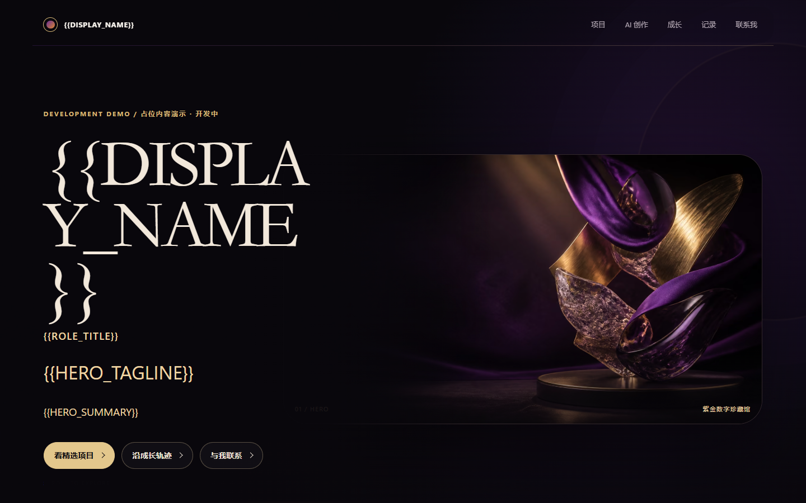

# Personal Brand Website · 紫金数字珍藏馆

把项目、研究、荣誉和成长轨迹组织成一页视觉档案：深紫、香槟金与暖色树脂串联长篇主页，显式 token 将排版原型与真实履历区分开。

**开发中 / Hero 长主页原型**。姓名、作品、奖项与简介仍是占位内容，页面明确标记演示身份，不代表作者已完成相关项目或获得对应荣誉。

[在线预览](https://yangwei251003.github.io/personal-brand-website/) · [本次验证](docs/OPEN_SOURCE_VALIDATION.md) · [素材与许可](THIRD_PARTY_ASSETS.md) · [更新记录](CHANGELOG.md)



## 功能与技术

- 单页项目、AI 创作、荣誉、时间线、文章/视频/图库预留与联系区；锚点导航、键盘菜单、skip link。
- 显式 token 与 placeholder / empty / ready 状态；未填写联系方式和未开发内页不产生坏链接。
- AVIF/WebP 响应式图片、手机裁切、Reduced Motion / Save-Data 回退；无需 WebGL 阅读核心内容。
- Next.js **16.4.3** / React 19 / TypeScript 5.9 / Tailwind 4；ESLint、Node 测试、Playwright 与 axe。

## 快速启动

安装 Node.js 24 与 npm（本次 Node24.15.0 / npm11）。首次安装需联网，不需要账号、模型或密钥。

```sh
git clone https://github.com/yangwei251003/personal-brand-website.git
cd personal-brand-website
npm ci
npm run build
npm run preview
```

打开 **http://127.0.0.1:3000**。开发使用 `npm run dev`。预览只提供 `out/` 静态文件，请通过 HTTP 打开。

Pages 工作流按仓库名设置 `NEXT_PUBLIC_BASE_PATH`，在 main 提交后构建并发布 out；源码和必要资产保留，远端成功状态以实际 Pages 部署为准。

## 内容与目录

在 `src/content/placeholders.ts` 查 token，在 `src/content/profile.ts` 填入本人愿意公开且可核实的内容，并更新对应状态。避免写入账户、财产、密钥、证件、真实住址/GPS 或私人联系方式。

```text
src/app/                 长主页、布局和样式
src/content/             内容、token、结构与状态
src/components/          单页交互
public/assets/hero/      生产 AVIF / WebP
docs/hero/visuals/        自有抽象图像母版
docs/                    设计记录、验证与真实截图
tests/                   内容、资产、动效、浏览器与 axe 检查
scripts/                 静态预览和依赖通知
```

## 检查与边界

```sh
npm run lint
npm run typecheck
npm run test:unit
npm run test:e2e
npm run licenses:generate
```

E2E 需要已安装 Chrome，会先生产构建，包含实验室性能阈值。自动无障碍检查不等于人工全面认证；结果见本次验证文档。

当前仅有 / 长主页，没有正式项目/文章内页、CMS、数据库、真实视频或联系表单后端。后续是填写已核验内容并按需求扩展内页；历史设计记录中的目标不代表已实现。

自有代码/文档为 [MIT](LICENSE)，图像与依赖保留原条款。保存完整自有源码、必要母版和派生图；排除依赖、缓存、私有配置、临时构建。原件需待远端完整性核对及用户后续清理决定后再讨论删除。

## 源码归档与校验范围

Git按原始字节保存归档文件，校验清单仅覆盖实际提交的文件。Next项目的`next-env.d.ts`遵循原`.gitignore`，由首次启动或构建生成；依赖、构建缓存与本机配置不入库。


静态分发同时附带原许可文本：[在线第三方许可](https://yangwei251003.github.io/personal-brand-website/licenses/)。ReactBits、字体与依赖的授权范围以相应原文为准。
