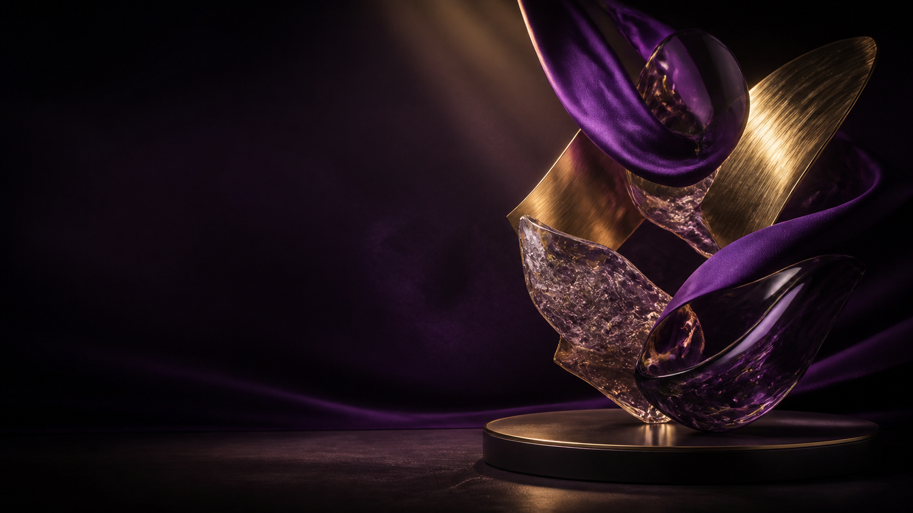
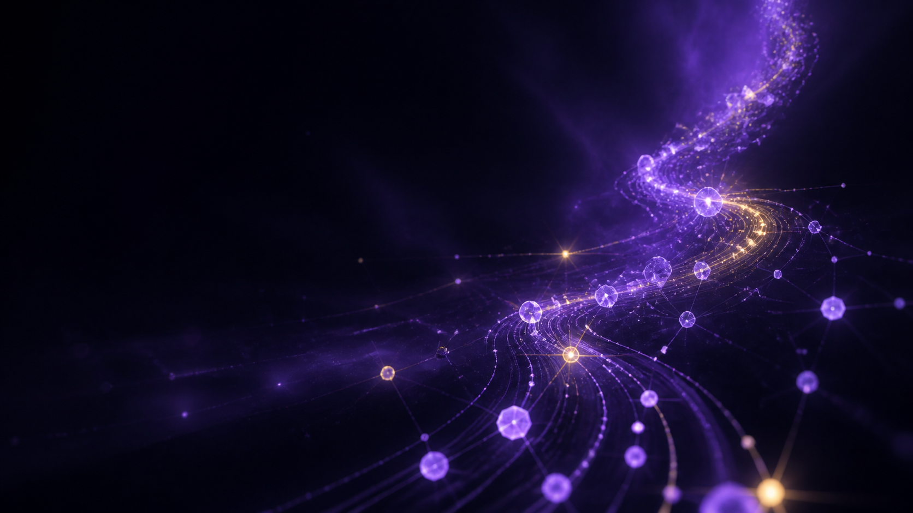
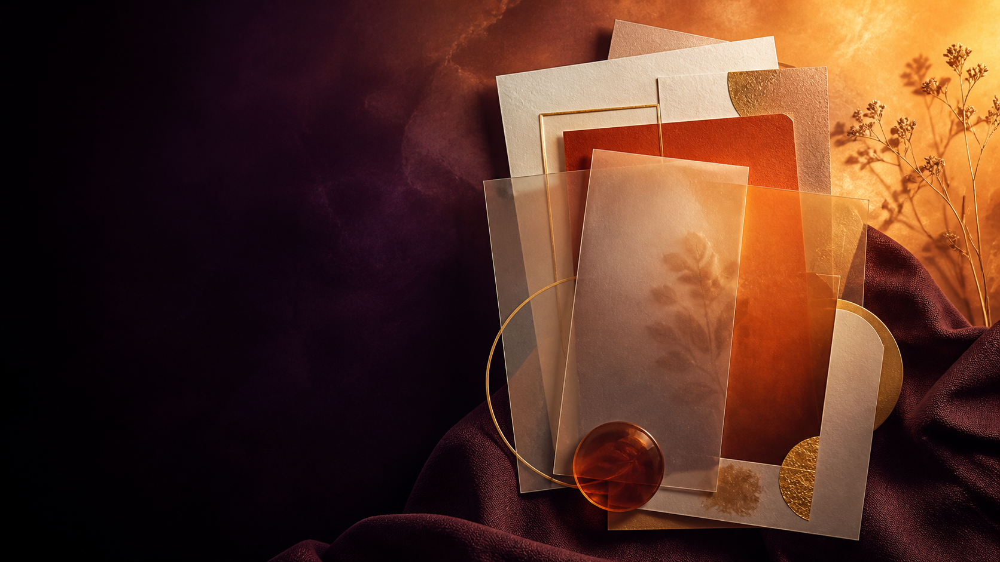

# Hero 视觉方向与资产策略

最后更新：2026-08-31  
状态：已选择并冻结混合方向；生产资产已优化入包。

## 冻结方向

- A 约 65%：首屏、身份、项目与整体材质/灯光。
- C 约 25%：荣誉、成长结果、博客编辑感与局部暖橙高潮。
- B 约 10%：仅从 AI 创作到成长时间线的纵向路径、稀疏节点与连接语法。
- B 不继承蓝黑星空、密集粒子、玻璃球或 HUD；C 不使用整屏亮橙；A 不使用珠宝品牌式夸张文案。
- 桌面 16:9 方向板只作母版。移动端另生成竖版构图，采用文字在上、视觉在下，不直接 `cover` 裁切。

## 已生成方向板

### A｜紫金数字珍藏馆

### B｜AI 成长星图

### C｜暖色成就档案

## 共通设计约束

- 16:9 方向板以可裁成 Hero 海报的单幅关键视觉呈现，不做带文字标签的拼贴。
- 左侧约 40–42% 保留低细节深色负空间；网页文字始终由 HTML 排版。
- 390px 使用独立移动端构图，至少保留一个清晰主体。
- 色彩沿长页从墨黑紫、皇家紫、香槟金进入琥珀/暖橙，页尾回到暗色。
- 禁止霓虹赛博朋克、默认声音、滚动劫持、隐藏光标和硬分区背景。

## A｜紫金数字珍藏馆

关键词：丝绸、拉丝金属、烟熏玻璃、透明树脂、克制博物馆射灯。  
气质：稀有、可信、收藏与长期成长。  
建议色板：`#09070D`、`#160B25`、`#5D2B91`、`#B98645`、`#F0D19B`。

方向板提示词：

> 创建一张横向 16:9 的高端个人品牌网站 Hero 艺术方向关键视觉。场景是克制、当代的“紫金数字珍藏馆”：深墨黑紫的沉浸式空间，右侧悬浮一组抽象雕塑，由浓郁皇家紫丝绸、香槟金拉丝金属、烟熏黑玻璃和细腻透明树脂构成；柔和博物馆射灯形成窄束暖金高光，材质有真实微表面、折射和克制反射。画面左侧约 42% 保留安静、低细节、足够深色的负空间，供后续 HTML 标题和按钮叠放；视觉重心偏右，前后层次清晰，具有珍藏、成长、稀有和可信赖的气质。电影感，编辑摄影，精密但不过度奢华，无人物。不要文字、字母、数字、标志、水印、证书、奖杯、品牌产品、网页 UI、按钮、设备框、霓虹赛博朋克、过度镜面、廉价金色、密集粒子或复杂背景。

## B｜AI 成长星图

关键词：空间节点、细轨迹线、透明数据晶体、金色脉冲、成长路径。  
气质：理性、年轻、连接、持续升级。  
建议色板：`#070812`、`#15102A`、`#6839B7`、`#B178ED`、`#F1C66B`。

方向板提示词：

> 创建一张横向 16:9 的高视觉冲击个人品牌网站 Hero 艺术方向关键视觉。主题是“AI 成长星图”：深黑蓝紫宇宙般的抽象空间中，一条由紫色微光节点、细致轨迹线、半透明数据晶体和少量香槟金脉冲组成的成长路径，从右下方逐渐向右上方展开；节点从稀疏到聚合，表达学习、连接、创造和持续升级，但不出现真实图表或文字。空间具有优雅景深、少量体积光和高精度科技感，避免通俗科幻界面。左侧约 40% 保持安静、深色、低粒子密度的负空间，中心与右侧形成有方向感的星图构图。不要文字、字母、数字、标志、水印、人物、机器人头像、大脑图标、电路板俗套、网页 UI、HUD、按钮、设备框、密集星空、蓝色企业科技模板或过量霓虹。

## C｜暖色成就档案

关键词：深茄紫纸张、压印金箔、赤陶树脂、暗色织物、编辑式阴影。  
气质：成果、人情味、策展与持续记录。  
建议色板：`#0B080C`、`#28102D`、`#7C3158`、`#C94F2D`、`#ECA942`、`#EED6B1`。

方向板提示词：

> 创建一张横向 16:9 的高端编辑设计个人品牌网站 Hero 艺术方向关键视觉。主题是“暖色成就档案”：从深茄紫背景自然过渡到琥珀、赤陶橙和柔和香槟金，一组无文字的半透明档案卡片、空白纸张边缘、压印金箔几何、暖色树脂片和深色织物在右侧形成有秩序的层叠构图；像一本被精心策展的个人成长档案，但没有真实证书、奖牌或任何可读信息。使用杂志编辑摄影般的阴影、纸张纤维、细腻金箔和温暖侧光。左侧约 42% 保留深色、低细节负空间，画面从紫色起步并在右侧达到金橙色高潮。不要文字、字母、数字、标志、水印、真实证书、真实印章、奖杯、品牌徽章、人物、网页 UI、按钮、设备框、复古剪贴簿俗套、凌乱文具或过饱和红色。

## 候选资产计划

已生成三张方向板并完成选择。其余资产统一使用冻结后的 A/C/B 配比；新增移动 Hero 竖版候选以解决桌面母版不可直接裁切的问题。

| ID | 资产 | 候选规格 | 入选后的生产目标 | alt 策略 |
|---|---|---:|---:|---|
| `DIR-A` | 紫金数字珍藏馆方向板 | 2400×1350 PNG | 1920×1080 AVIF ≤180 KB / WebP ≤250 KB | 生产 Hero 装饰图 `alt=""` |
| `DIR-B` | AI 成长星图方向板 | 2400×1350 PNG | 同上 | 同上 |
| `DIR-C` | 暖色成就档案方向板 | 2400×1350 PNG | 同上 | 同上 |
| `MAT-A/B/C` | 三套材质实验 | 1600×1600 PNG | 1024×1024 AVIF ≤90 KB | 文档描述材质 |
| `AVATAR-01` | 无脸抽象数字身份雕塑 | 1600×1600 PNG | 800×800 AVIF ≤100 KB | `{{DISPLAY_NAME}} 的抽象数字身份形象` |
| `PROJECT-01/02/03` | 三张抽象项目封面 | 1600×1200 PNG | 1200×900 AVIF ≤120 KB | 邻近标题重复时 `alt=""` |
| `HONOR-01` | 空展柜与抽象基座 | 1920×1200 PNG | 1440×900 AVIF ≤160 KB | `alt=""`，奖项只来自 HTML |
| `BLOG-01` | 无文字编辑纸张层 | 1440×960 PNG | 1200×800 AVIF ≤100 KB | `alt=""` |
| `VIDEO-01` | 光束与空白画框 | 1600×900 PNG | 1280×720 AVIF ≤120 KB | 无视频时不可播放 |
| `GALLERY-01` | 无内容透明相框 | 1200×1500 PNG | 960×1200 AVIF ≤120 KB | `alt=""` |
| `TEX-01` | 无缝深紫细颗粒 | 2048×2048 PNG | 1024×1024 AVIF ≤70 KB | CSS 背景 |

## 来源与许可证策略

- 首选 imagegen 与程序化几何；保存提示词、生成时间、原始文件与生成记录。[OpenAI 条款](https://openai.com/policies/terms-of-use/)
- 外部 HDRI、纹理或模型只接受逐项留档的 CC0；优先 [Poly Haven](https://polyhaven.com/license) 或 [ambientCG](https://docs.ambientcg.com/license/)。
- React Bits 当前为 MIT + Commons Clause，不能把组件本身作为模板出售或重新分发。[许可证](https://github.com/DavidHDev/react-bits/blob/main/LICENSE.md)
- Motion 为 MIT；OGL 为 Unlicense；Three.js 与 R3F 为 MIT。库许可证不覆盖外部模型、HDRI 或纹理。
- 当前无真实视频，不嵌入 YouTube/Vimeo 播放器；未来媒体需用户自有授权并提供字幕或文字稿。[W3C 媒体无障碍](https://www.w3.org/WAI/media/av/)

直接拒绝：Pinterest、Behance、Dribbble、搜索结果图片、他人网站截图、Editorial/NC/ND、许可证不明素材、可识别人物、第三方 Logo、知名角色、真实证书与奖项合成。

## 资产发布闸门

1. 原始候选只进入 `docs/hero/visuals/`。
2. 用户选中的方向才导出到 `public/assets/hero/`。
3. 生产目录只保留实际引用的 WebP/AVIF。
4. 图片不得包含个人事实；事实始终由 HTML token 提供。
5. 每项资产记录来源、许可证、尺寸、字节、哈希、alt、优化与采用状态。
